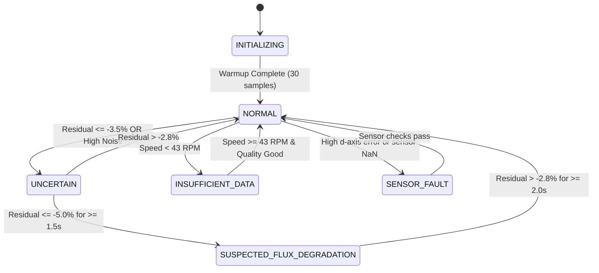

# Flux Estimator & Diagnostic Engine Architecture

## 1. Voltage-Model Flux Estimator
The fundamental principle of the voltage-model flux observer is rearranging the stator $q$-axis voltage equation:
$$v_q = R_s i_q + L_q \frac{di_q}{dt} + \omega_e L_d i_d + \omega_e \psi_f$$

Solving for permanent-magnet flux linkage $\psi_f$:
$$\hat{\psi}_f = \frac{v_q - R_s i_q - L_q \frac{di_q}{dt} - \omega_e L_d i_d}{\omega_e}$$

### 1.1 Operating Assumptions
1. **Steady-State or Quasi-Steady State**:
   When acceleration is moderate ($|d\omega_e/dt| < 500\,\text{rad/s}^2$) and torque command is not stepping rapidly, the derivative term $L_q \frac{di_q}{dt}$ is either small or can be filtered using a digital low-pass filter:
   $$\hat{\psi}_{f,\mathrm{steady}} = \frac{v_q - R_s i_q - \omega_e L_d i_d}{\omega_e}$$
2. **Current Decoupling**:
   Standard Surface-Mounted PMSMs operate with $i_d^* = 0$ (Maximum Torque Per Ampere, MTPA). Thus, cross-coupling term $\omega_e L_d i_d \approx 0$, simplifying the back-EMF calculation.

---

## 2. Low-Speed Observability Singularity
A critical vulnerability in flux estimation is speed sensitivity:
$$\lim_{\omega_e \to 0} \frac{v_q - R_s i_q}{\omega_e} = \left[\frac{0}{0}\right]$$

### 2.1 Physics of Low-Speed Breakdown
1. **Back-EMF Dominance Lost**: Back-EMF is directly proportional to speed: $e_q = \omega_e \psi_f$. At 30 RPM ($p=4$, $\omega_e = 12.5\,\text{rad/s}$), $e_q \approx 1.06\,\text{V}$.
2. **Resistive Drop Dominance**: A 4 A phase current across $0.45\,\Omega$ produces a $1.8\,\text{V}$ resistive drop. Small uncertainties in temperature-dependent resistance ($\Delta R_s$) exceed the entire back-EMF signal.
3. **Inverter Forward Drops**: IGBT/MOSFET forward voltage ($V_{ce,\mathrm{sat}} \approx 0.8\text{--}1.4\,\text{V}$) and PWM dead-time ($1.2\,\mu\text{s}$) introduce voltage errors larger than $e_q$.

### 2.2 Observability Cutoff
FluxGuard enforces an absolute low-speed cutoff:
$$\text{If } |\omega_e| < 18.0\,\text{rad/s} \quad (\approx 43\,\text{RPM for } p=4):$$
$$\text{Validity} = \text{FALSE}, \quad \text{State} = \mathrm{INSUFFICIENT\_DATA}, \quad \text{Uncertainty} = 1.0$$
This eliminates numerical divergence and division-by-near-zero false positives.

---

## 3. Cross-Check Verification ($d$-axis Residual)
To detect sensor bias, gain error, or motor inductance mismatch, FluxGuard continuously computes the direct-axis voltage error:
$$e_d = \left| v_d - \left( R_s i_d + L_d \frac{di_d}{dt} - \omega_e L_q i_q \right) \right|$$
Under healthy operation, $e_d \approx 0$. If $e_d > 0.30 \cdot V_{\max}$, current-sensor drift or inaccurate parameter calibration is flagged as `SENSOR_FAULT`.

---

## 4. Temperature-Compensated Residual
$$r_\psi = \frac{\hat{\psi}_f - \psi_{\mathrm{healthy}}(T)}{\psi_{\mathrm{healthy}}(T)} \times 100\%$$
Where:
$$\psi_{\mathrm{healthy}}(T) = \psi_{\mathrm{ref}} \left[ 1 + \alpha_\psi (T - T_{\mathrm{ref}}) \right]$$

### 4.1 Diagnostic Thresholds & Hysteresis
- **Warning Alert Threshold**: $-3.5\%$
- **Fault Entry Threshold**: $-5.0\%$
- **Recovery Hysteresis Threshold**: $-2.8\%$
- **Persistence Duration ($t_{\mathrm{persist}}$)**: $1.5\,\text{seconds}$ (30 consecutive samples at 20 Hz)

