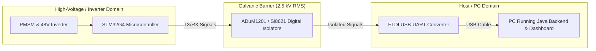

# Hardware Design & Microcontroller Interface

## 1. Microcontroller Selection: STM32G474RE
The STM32G4-family is STMicroelectronics' specialized microcontroller line for motor control and power conversion.

### Key Hardware Peripherals
- **Core**: ARM 32-bit Cortex-M4 with single-precision hardware FPU and DSP instructions, clocked at $170\,\text{MHz}$ ($213\,\text{DMIPS}$).
- **Hardware Accelerators**:
  - **CORDIC**: Hardware trigonometric and polar/cartesian converter (accelerates Clarke/Park transforms in $< 20$ clock cycles).
  - **FMAC**: Filter-Math Accelerator (FIR/IIR low-pass filter execution in hardware).
- **Analog Front End**:
  - Up to 5 ultra-fast $12\text{-bit}$ ADCs ($4.0\text{--}5.0\,\text{MSPS}$ conversion speed, hardware oversampling to $16\text{-bit}$).
  - 4 internal rail-to-rail Operational Amplifiers (PGA mode with configurable gain $2\times, 4\times, 8\times, 16\times, 32\times$).
  - 7 high-speed analog comparators ($16.7\,\text{ns}$ propagation delay) for hardware cycle-by-cycle over-current shutdown.
- **Timers**:
  - `TIM1`: $16\text{-bit}$ advanced motor control timer ($170\,\text{MHz}$, complementary PWM outputs, programmable dead-time, ADC trigger synchronization).
  - `TIM2`: $32\text{-bit}$ general-purpose timer configured in Quadrature Encoder Interface mode (X4 decoding).

---

## 2. Sensor Signal Conditioning Circuits

### 2.1 3-Shunt Low-Side Current Sensing
Low-side current sensing is implemented using $20\,\text{m}\Omega$ precision surface-mount shunt resistors ($1\%$ tolerance, $50\,\text{ppm/K}$).
- Shunt resistance: $R_{\mathrm{shunt}} = 0.020\,\Omega$.
- Differential amplifier gain: $A_v = 20\,\text{V/V}$.
- Mid-rail reference bias: $V_{\mathrm{ref}} = 1.65\,\text{V}$ (generated via filtered resistor divider or internal DAC).
- Output voltage relation:
  $$V_{\mathrm{ADC}} = 1.65\,\text{V} + (i_{\mathrm{phase}} \cdot R_{\mathrm{shunt}} \cdot A_v) = 1.65\,\text{V} + (i_{\mathrm{phase}} \cdot 0.40\,\text{V/A})$$
- Measuring range: $-3.5\,\text{A}$ to $+3.5\,\text{A}$ corresponds to $0.25\,\text{V}$ to $3.05\,\text{V}$ at the ADC input pin.

### 2.2 DC Bus Voltage Sensing
High-voltage DC bus is stepped down using a high-impedance resistive divider with anti-aliasing RC filtering:
- $R_{\mathrm{top}} = 100\,\text{k}\Omega$, $R_{\mathrm{bottom}} = 4.7\,\text{k}\Omega$.
- Attenuation ratio:
  $$\alpha_v = \frac{4.7\,\text{k}\Omega}{100\,\text{k}\Omega + 4.7\,\text{k}\Omega} \approx 0.04489$$
- Maximum measurable DC bus voltage: $V_{\mathrm{bus},\max} = \frac{3.3\,\text{V}}{0.04489} \approx 73.5\,\text{V}$.

### 2.3 Magnet Temperature Measurement (NTC)
A $10\,\text{k}\Omega$ NTC thermistor ($B = 3950\,\text{K}$) is affixed to the motor casing or embedded near the stator teeth.
- Voltage divider with $10\,\text{k}\Omega$ pull-up to $3.3\,\text{V}$:
  $$R_{\mathrm{NTC}} = 10000 \cdot \frac{V_{\mathrm{ADC}}}{3.3 - V_{\mathrm{ADC}}}$$
- Temperature calculated via the Steinhart-Hart equation:
  $$\frac{1}{T} = \frac{1}{T_0} + \frac{1}{\beta} \ln\left(\frac{R_{\mathrm{NTC}}}{R_0}\right)$$

---

## 3. Galvanic Isolation Architecture

Isolation protects host USB ports, measurement instruments, and developers from common-mode ground loops and high-voltage inverter transients.
