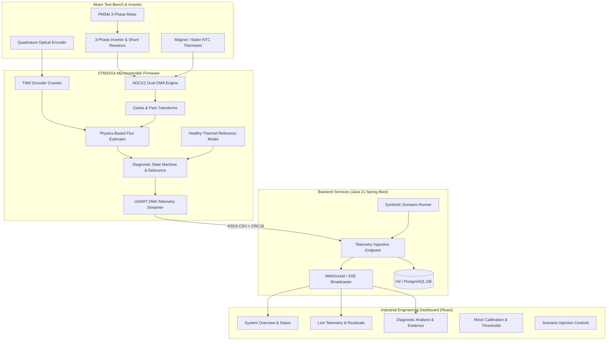

# FluxGuard PMSM — Project Overview

## 1. Executive Summary
**FluxGuard PMSM** is an embedded, physics-based diagnostic and health-monitoring system designed for Permanent-Magnet Synchronous Motors (PMSMs). Its primary mission is to distinguish genuine permanent-magnet flux degradation (demagnetization) from reversible temperature-dependent flux variations, measurement noise, sensor offsets, and transient dynamic maneuvers.

Traditional condition monitoring systems either rely on generic motor vibration thresholds or simple heuristic thresholds on phase current amplitude. Such approaches fail to identify early-stage flux degradation because:
1. Field-Oriented Control (FOC) speed loops automatically compensate for reduced rotor flux by increasing stator quadrature current ($i_q$), masking the underlying magnetic defect until severe overcurrent or thermal runaway occurs.
2. Permanent magnet materials (e.g. NdFeB, SmCo, Ferrite) exhibit a pronounced reversible reduction in remanent magnetic flux density ($B_r$) with increasing temperature ($\alpha_\psi \approx -0.11\%/\text{K}$ for NdFeB). Without rigorous temperature compensation, normal operating thermal excursions trigger false demagnetization alarms.
3. Voltage-model back-EMF flux estimation degrades severely at low rotor speeds ($|\omega_e| < 18\,\text{rad/s}$) due to inverter dead-time distortion, resistance variation, and division-by-near-zero numerical instability.

FluxGuard PMSM addresses these challenges with an integrated hardware-software architecture spanning an STM32G4-class embedded microcontroller, a high-throughput Java 21 Spring Boot telemetry backend, and a real-time React/TypeScript engineering dashboard.

---

## 2. System Architecture

---

## 3. Core Contributions
1. **Physics-Based Voltage-Model Estimator**:
   Implements continuous back-EMF integration in the rotor reference frame ($d$-$q$):
   $$\hat{\psi}_f = \frac{v_q - R_s i_q - L_q \frac{di_q}{dt} - \omega_e L_d i_d}{\omega_e}$$
2. **Reversible Thermal Compensation**:
   Accounts for temperature changes before calculating degradation residuals:
   $$\psi_{\mathrm{healthy}}(T) = \psi_{\mathrm{ref}} \left[1 + \alpha_\psi (T - T_{\mathrm{ref}})\right]$$
3. **Normalized Residual Metric ($r_\psi$)**:
   Evaluates deviations against the calibrated healthy model:
   $$r_\psi = \frac{\hat{\psi}_f - \psi_{\mathrm{healthy}}(T)}{\psi_{\mathrm{healthy}}(T)} \times 100\%$$
4. **Hysteresis and Debounce State Machine**:
   Prevents false alarms during rapid speed or torque transients by enforcing a 1.5-second persistence window and a 2.2% hysteresis recovery band.
5. **Observability Boundary & Data Quality Monitor**:
   Detects low-speed operation, current sensor offsets, and voltage saturation, marking data as `INSUFFICIENT_DATA` or `UNCERTAIN` rather than incorrectly reporting demagnetization.
